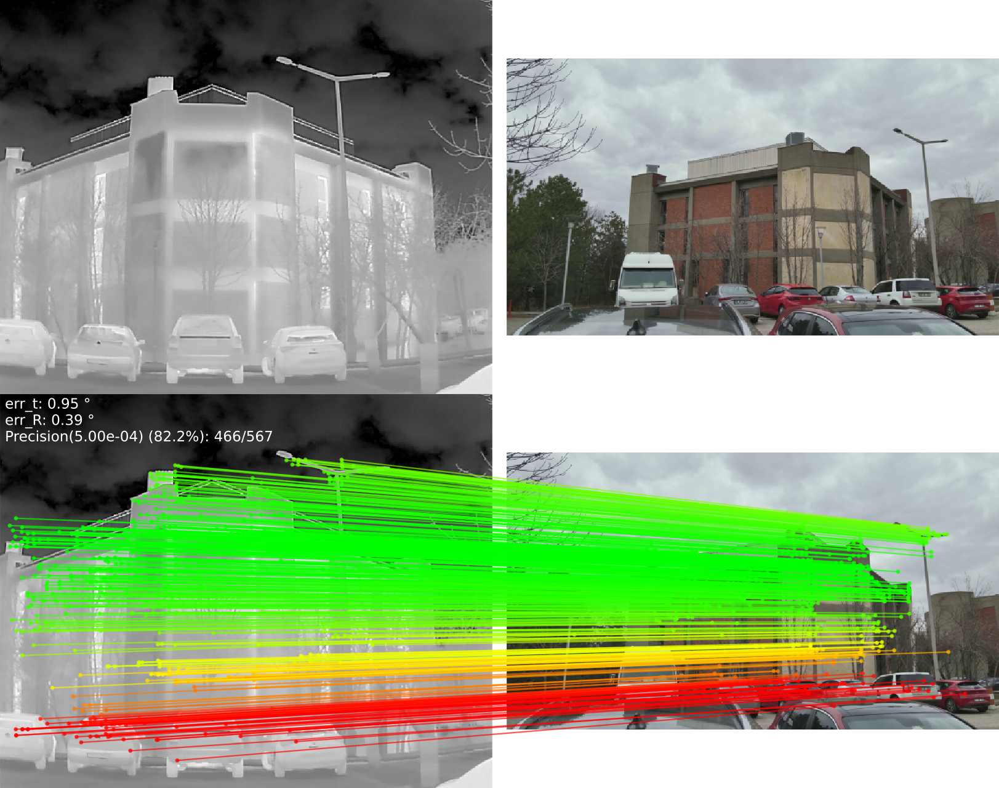

# GeoSAM

## Geometry-Guided Semantic Alignment and Saliency-Aware State Space Model for Generalizable Cross-Modal Image Matching

This is the official implementation of **GeoSAM**, a cross-modal local feature matcher for visible/thermal, optical/SAR, and other cross-modal image pairs. GeoSAM combines frozen DINOv3 semantic features with CNN structural features, geometry-guided semantic alignment (GGSA), and a saliency-aware state space matching module.

> **Status.** This repository accompanies the GeoSAM manuscript submitted to the *ISPRS Journal of Photogrammetry and Remote Sensing*. Publication and citation details will be updated when the final article is available.

## Method overview

The public code contains the training pipeline, GeoSAM model variants, dataset loaders, evaluation scripts, configuration files, and demo notebooks. The main implementation is exposed through `src.geosam` and remains compatible with the original `src.xoftr` import paths used by the training and evaluation scripts.

The paper trains on MegaDepth and evaluates zero-shot on cross-modal benchmarks, including METU-VisTIR, MSRS, RoadScene, LLVIP, FMB, optical–SAR pairs, and day–night pairs. The manuscript reports METU-VisTIR AUC@20 scores of 58.79 (cloudy–cloudy) and 48.57 (cloudy–sunny).



## Repository layout

```text
GeoSAM/
├── assets/                 # Small figures used in the README
├── configs/                # Dataset and model configurations
├── data/                   # Dataset location (contents are not redistributed)
├── docs/                   # Reproduction notes
├── notebooks/              # Pair-matching demos
├── scripts/reproduce_train/
├── src/
│   ├── geosam/             # Public GeoSAM aliases
│   ├── xoftr/              # Model and backbone implementation
│   ├── jamma/              # State space matching blocks
│   ├── datasets/            # MegaDepth, ScanNet, and VisTIR loaders
│   └── lightning/           # PyTorch Lightning data/model modules
├── test_relative_pose.py   # METU-VisTIR relative-pose evaluation
├── train.py                # GeoSAM training entry point
└── pretrain.py             # Optional pretraining entry point
```

The repository intentionally excludes datasets, experiment logs, private server paths, and model checkpoints. A checkpoint is around 90 MiB and should be downloaded separately or supplied through a release asset.

## Installation

The reference environment uses Python 3.10, PyTorch 2.0.1, and CUDA 11.8 on Linux.

```bash
conda env create -f environment.yaml
conda activate geosam
```

`mamba-ssm` may require a matching CUDA toolkit and a source build on your platform. If pip cannot find a compatible wheel, install it following the upstream instructions before importing `src.geosam`.

### DINOv3 backbone

The DINOv3 repository and pretrained weights are not redistributed here. Download them from the official DINOv3 release and either place them at the relative paths used by the backbone wrappers (`third_party/dinov3` and `weights/`) or edit the paths in `src/xoftr/backbone/`. Keep all downloaded weights outside Git history.

## Data preparation

Download the datasets from their official sources and follow the layouts expected by `configs/data/`:

- **MegaDepth** for training: place images and scene metadata under `data/megadepth/`.
- **METU-VisTIR** for cross-modal relative-pose evaluation: the dataset and its index files go under `data/METU_VisTIR/`. The original public download is available from the [XoFTR dataset link](https://drive.google.com/file/d/1Sj_vxj-GXvDQIMSg-ZUJR0vHBLIeDrLg/view?usp=sharing).
- **KAIST** is only needed for the optional pretraining configuration in `configs/data/pretrain.py`.

The datasets are governed by their own licenses. Check those terms before redistributing images or derived files.

## Inference

After downloading a GeoSAM checkpoint, run the METU-VisTIR benchmark from the repository root:

```bash
python test_relative_pose.py xoftr \
  --data_root_dir data/METU_VisTIR \
  --ckpt /path/to/geosam.ckpt \
  --save_dir results/metu_vistir \
  --save_figs
```

For a single pair or a folder of image pairs, see `test_one_image.py` and `test_folder.py`. Those scripts accept local image paths and use the same `--ckpt` checkpoint wrapper. The evaluation scripts write JSON metrics and optional match figures to the directory passed by `--save_dir`.

## Training

The paper's main training configuration is MegaDepth with 640-pixel image resizing. A multi-GPU example is:

```bash
python train.py \
  configs/data/megadepth_vistir_trainval_640.py \
  configs/xoftr/outdoor/visible_thermal.py \
  --exp_name geosam \
  --gpus 4 --num_nodes 1 --accelerator ddp \
  --batch_size 2 --num_workers 16 \
  --max_epochs 30
```

The same command is available as `scripts/reproduce_train/visible_thermal.sh`. Adjust the number of GPUs, workers, and dataset paths for your machine. For optional pretraining, use `scripts/reproduce_train/pretrain.sh` with `configs/data/pretrain.py`.

Additional reproduction notes and expected directory layouts are in [`docs/REPRODUCTION.md`](docs/REPRODUCTION.md).

## Citation

Please use the following provisional BibTeX entry until the final publication metadata is available:

```bibtex
@article{zhang2026geosam,
  title   = {GeoSAM: Geometry-Guided Semantic Alignment and Saliency-Aware State Space Model for Generalizable Cross-Modal Image Matching},
  author  = {Zhang, Zhizheng and Jiang, Ruixuan and Wei, Pengcheng and Li, Zijuan and Zhang, Jindou and Cao, Rui and Yang, Meng and Shao, Zhenfeng and Ma, Jiayi and Li, Deren},
  journal = {ISPRS Journal of Photogrammetry and Remote Sensing},
  year    = {2026},
  note    = {Publication details forthcoming}
}
```

## Acknowledgements

This implementation builds on ideas and code from [XoFTR](https://github.com/OnderTuzcuoglu/XoFTR) and [LoFTR](https://github.com/zju3dv/LoFTR). Please cite the upstream projects when using the corresponding components. DINOv3 is provided by [Meta AI](https://github.com/facebookresearch/dinov3) under its own license.

## License

The repository is released under the Apache License 2.0. Third-party datasets, pretrained models, and upstream components retain their original licenses; see [`LICENSE`](LICENSE) and [`NOTICE`](NOTICE).

